# Urban Pulse UI, UX and accessibility audit

Date: 2 November 2026  
Scope: all reachable frontend routes and role-specific navigation for Citizen, Operator, Technician and Admin; default desktop viewport plus a 390 px mobile check; implementation review of the React screens and shared components.  
Target: practical WCAG 2.2 AA improvements, without claiming formal conformance.

## Overall verdict

Urban Pulse has a clean visual language, clear Spanish copy, consistent status treatments, strong focus rings, native form controls, and sensible role separation for the three working roles. The main problems are structural rather than cosmetic:

1. Admin is a real/demo role but lands on a broken dashboard with a broken notification destination.
2. The operator table is not usable at mobile width: most columns and the action are off-screen with no cue.
3. Technician and operator primary actions move below long informational content on narrower screens.
4. The dashboard is much longer than the job it supports and shows low-value zero/empty analytics, especially for technicians.
5. Several controls have incomplete accessible state or labelling: menu keyboard behavior, two filter labels, view toggles, the “Sin técnico” toggle, pagination buttons, validation errors, and map selection.
6. Maps hide non-geocoded incidents and do not provide an equivalent keyboard-friendly selection method.

## Priority changes

### P0 — broken or blocking

- Give `ADMIN` and `ANALYST` a supported landing page, or prevent those roles from being provisioned until one exists. The Admin demo account currently receives “No se ha podido cargar el panel”; the bell points to `/my-incidents`, which immediately redirects back to the same broken panel.
- Replace the operator table with responsive cards below the desktop breakpoint, or add an obvious labelled horizontal-scroll container with sticky incident and action columns. At 390 px, priority and all later columns—including “Revisar”—are clipped.
- On technician job details, place “Iniciar trabajo”, “Guardar notas”, and “Marcar como resuelta” before attachments/history on mobile, ideally as a sticky bottom action area. The current two-column DOM order puts the action sidebar after the entire detail column.

### P1 — high impact

- Replace the generic five-section dashboard with role-specific summaries. For technicians, lead with today’s assigned work, route/location and primary next action; hide zero-value cards, empty distribution panels and the 320 px blank map. For citizens, lead with current reports. For operators, lead with the validation/assignment queue.
- Remove the bell until it opens a distinct notification/attention surface. Today it duplicates “Mis incidencias”, “Incidencias” or “Mis trabajos”; for Admin it is broken.
- Make the user menu a real keyboard menu: move focus into it, support Escape and arrow keys, close on focus-out, return focus to the trigger, and add a visible focus style to the menu item. Escape was tested and did not close the menu.
- Make maps honest about coverage: “1 of 5 incidents shown; 4 have no coordinates.” In the operator map, keep a linked list of unlocated results. Do not describe the current-page-only subset as the whole filtered result set.
- Add a non-map location path: address search/geocoding or labelled latitude/longitude inputs. Clicking the Leaflet canvas and dragging its marker are not keyboard-equivalent controls.
- Associate every field error with its input using `aria-invalid` and `aria-describedby`; focus the first invalid field after submit and announce mutation success with `role="status"`/a live region.

### P2 — important refinement

- Add `aria-current="page"` to active navigation links. On mobile, do not rely on the logo as the only route back to the dashboard; use a compact menu or explicit “Panel” item.
- Give the Lista/Mapa and “Sin técnico” controls `aria-pressed`, and give the group an appropriate labelled toggle/radio-group pattern. Disable or hide “Limpiar” when nothing is applied.
- Give Estado and Prioridad filter selects stable IDs and connected labels. Their visible labels were not exposed as accessible names.
- Give pagination arrow buttons names such as “Página anterior” and “Página siguiente”.
- Increase the visual contrast of input borders (currently about 1.36:1 against white) and darken the green text used in the 12 px resolved badge (about 4.10:1 on its background; normal text needs 4.5:1).
- Add a skip link and meaningful busy/loading announcements (`aria-busy`, live status text). The incident-list skeleton initially appeared as blank white content to both the visual and accessibility pass.
- Preserve a selected attachment until upload succeeds. The current component clears the chosen file immediately, so a failed upload forces reselection.

## Screen-by-screen findings

### 1. Public home — healthy with low-value elements

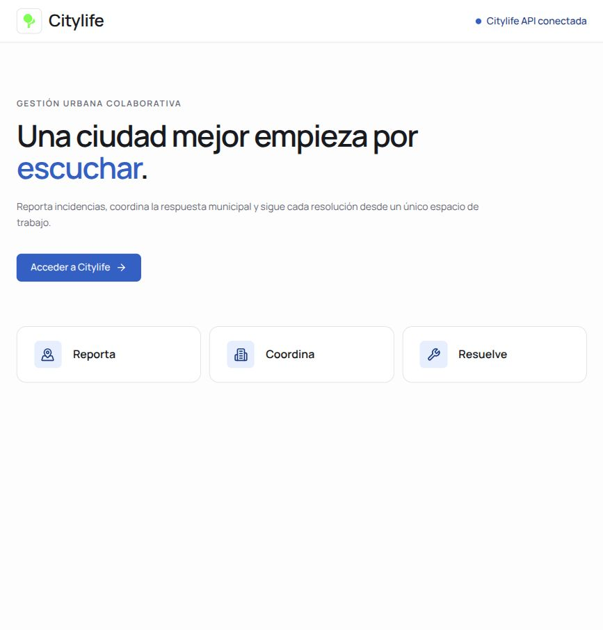

- Keep: concise proposition, one primary CTA, strong heading and readable spacing.
- Remove or demote “Urban Pulse API conectada”; it is implementation health, not a public user goal. Show a service notice only when availability affects access.
- The three cards “Reporta / Coordina / Resuelve” repeat verbs without explaining benefits or linking anywhere. Either add one useful sentence per role or remove the row.
- If citizen acquisition matters, expose “Crear cuenta” here rather than only after opening login.

### 2. Login — generally healthy

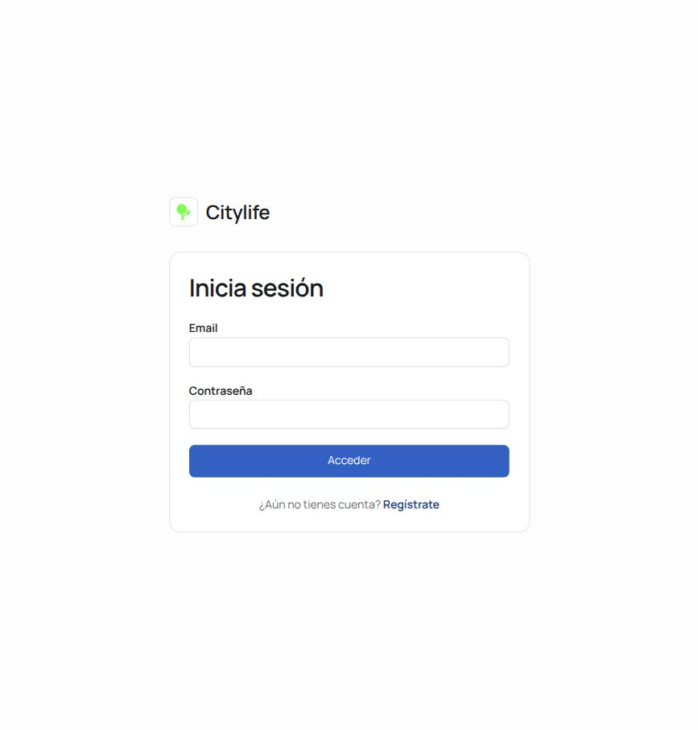

- Add a show/hide-password control and, for a production service, a recovery route.
- Use “Correo electrónico” consistently instead of mixing Spanish UI with “Email”.
- Connect validation errors to their fields and focus the first invalid field.
- The API error uses `role="alert"`, which is good.

### 3. Registration — needs guidance

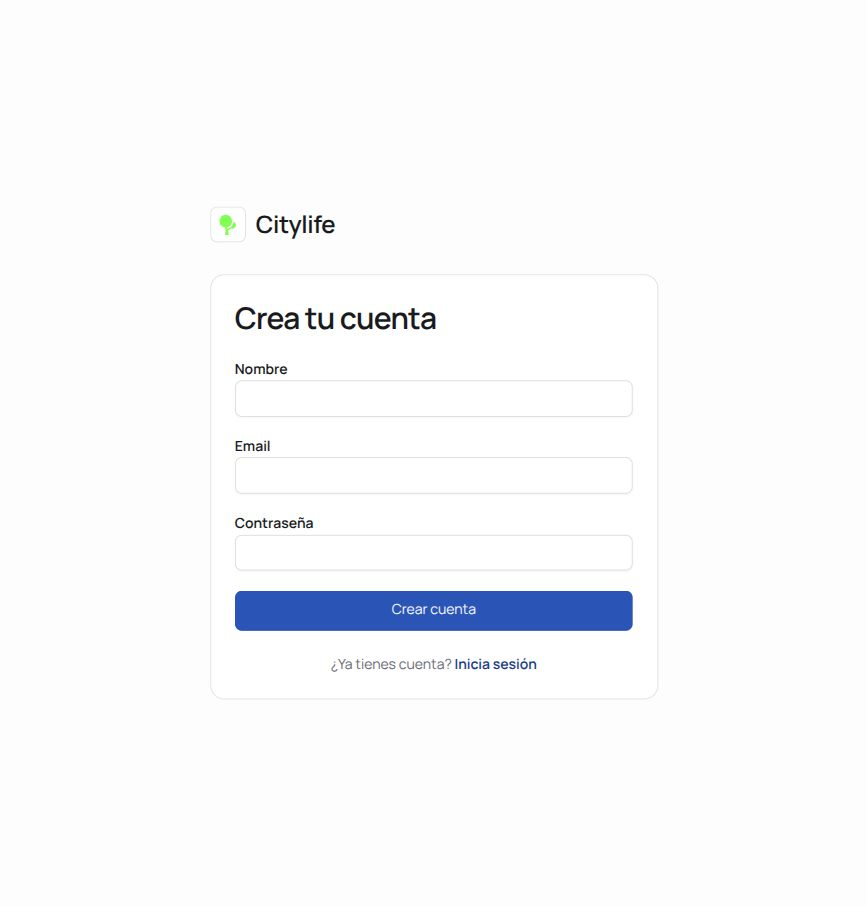

- Show the 8-character password requirement before submit; currently it appears only after failure.
- Mark fields as required programmatically, not only through schema validation.
- Add privacy/terms context before creating a public-service account if this moves beyond an internal MVP.
- Add password visibility and error associations.

### 4. Citizen dashboard — visually strong, too much analytics

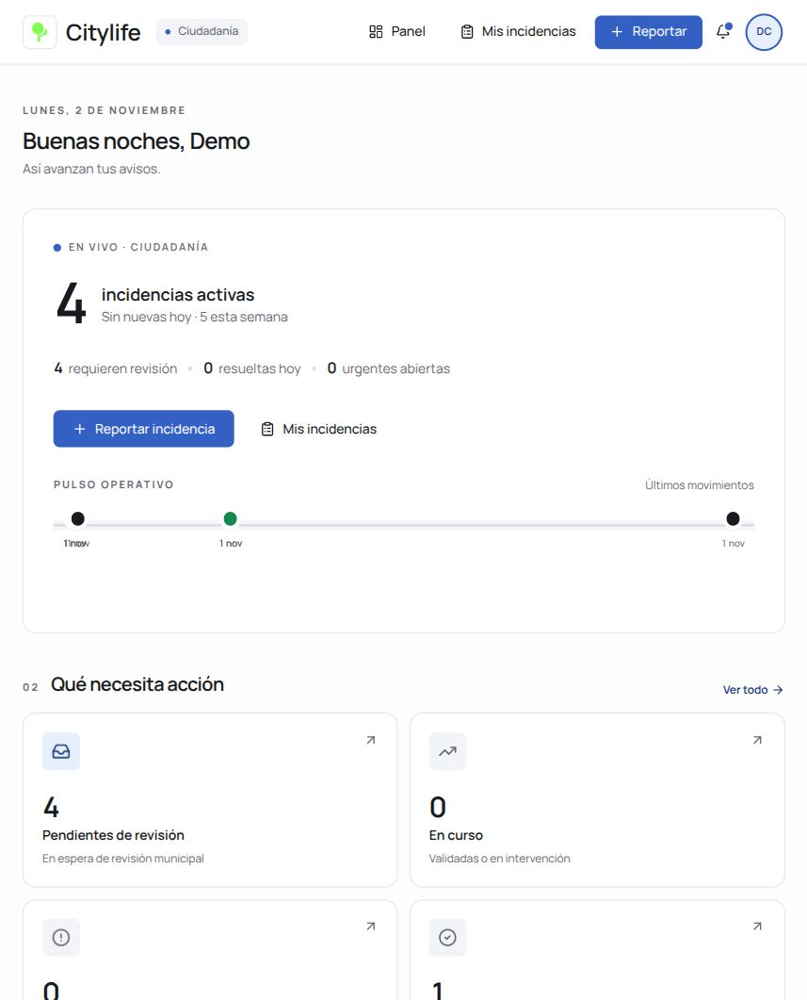

- Keep the active count and two primary actions.
- Remove duplicate destinations: header “Reportar”, hero “Reportar incidencia”, header “Mis incidencias”, hero “Mis incidencias”, bell, “Ver todo” and multiple cards all compete.
- Citizen distribution/district links all lead to the same unfiltered list, so they look more specific than they are. Add citizen filters or render them as non-interactive summaries.
- “En vivo” is misleading without live subscription or a visible freshness timestamp.
- The operational pulse compresses several same-day labels until they overlap, and its rich tooltip is hover-only. Support keyboard focus and avoid plotting duplicate timestamps on top of one another.
- Section numbering begins at “02” with no visible “01”, which reads like a missing section.

### 5. User menu — accessibility fix required

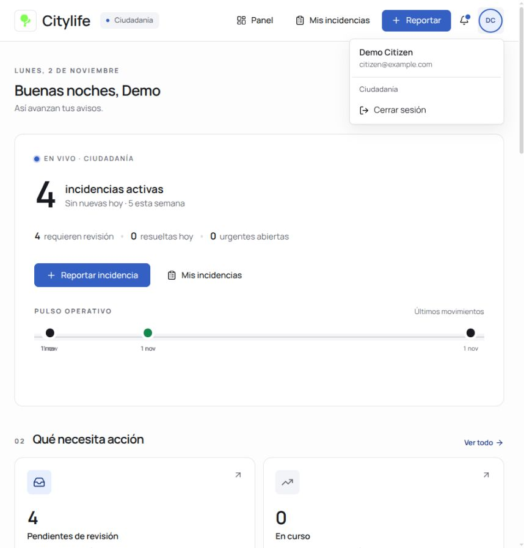

- Escape did not close the open menu in the live keyboard check.
- Focus stays on the trigger instead of moving to “Cerrar sesión”; arrow-key navigation and focus return are missing.
- The logout item has no explicit focus-visible styling.
- The role is repeated in the header chip and again in the menu; keep it in one place unless role switching is planned.

### 6. Citizen incident list — healthy for small data, weak at scale

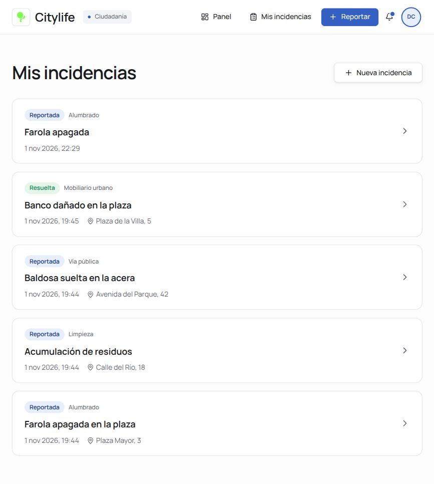

- The cards are clear, fully clickable and keyboard focusable.
- “Nueva incidencia” duplicates the persistent “Reportar” header action.
- Add status/category filtering and sorting when the list grows; the current screen has no way to find an older report.
- Avoid visual title truncation without a visible way to reveal the full title.

### 7. New incident — usable, but location dominates

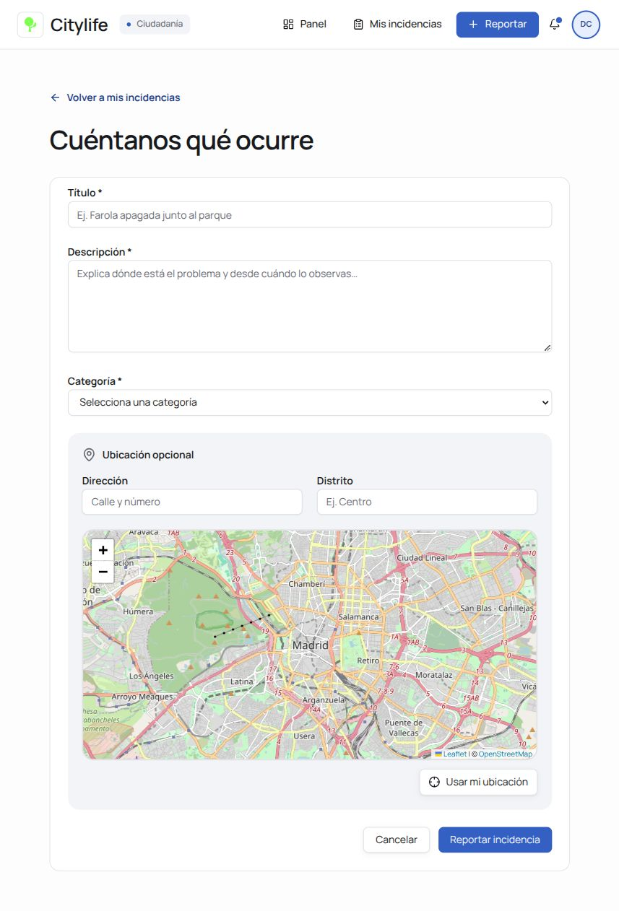

- Collapse “Ubicación opcional” by default or ask for address first, then reveal the map only when needed. The optional map occupies more space than the required report.
- Address, district and pin can contradict each other. Geocode/synchronise them or make one source of truth.
- Add instructions such as “Click or use the address search to place the pin.” The map click/drag interaction is not keyboard accessible.
- Explain why “Usar mi ubicación” is useful before requesting browser permission.
- Show title/description limits before errors; connect errors with `aria-describedby`/`aria-invalid`.
- The back link and Cancel button perform the same action; one clear escape is enough.

### 8. Citizen incident detail — informative, over-exposes technical detail

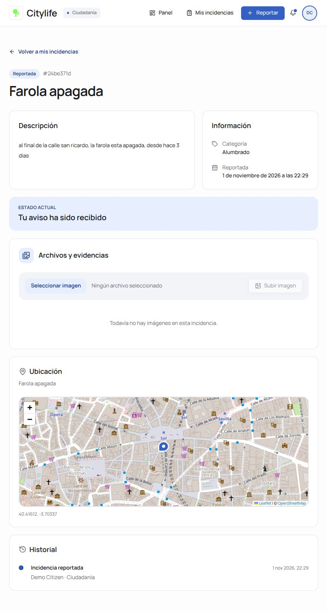

- Merge the status badge and large “Estado actual” panel; they communicate the same state.
- Hide the UUID fragment from citizens unless it is an official support/reference number with a Copy action.
- Hide raw coordinates by default; the address/map is the user-facing value.
- Explain file types and the 5 MB limit before selection, not only after an invalid choice.
- Translate internal actor/role language in the timeline into citizen-friendly updates.

### 9. Operator dashboard — useful queue, excessive scroll

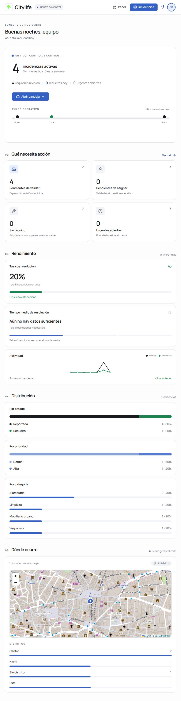

- Keep “Qué necesita acción”; it is the highest-value part.
- Move it above or into the hero. Distribution and territory analytics should be secondary/collapsible or a separate analytics view.
- Hide cards with zero values unless zero is genuinely reassuring.
- The dashboard is over 3,300 px tall at the audited viewport, delaying access to the queue.
- “4 distritos” includes “Sin distrito”, so the label is inaccurate; say “4 district groups” or exclude missing data.

### 10. Operations queue — good filters, major responsive/accessibility issues

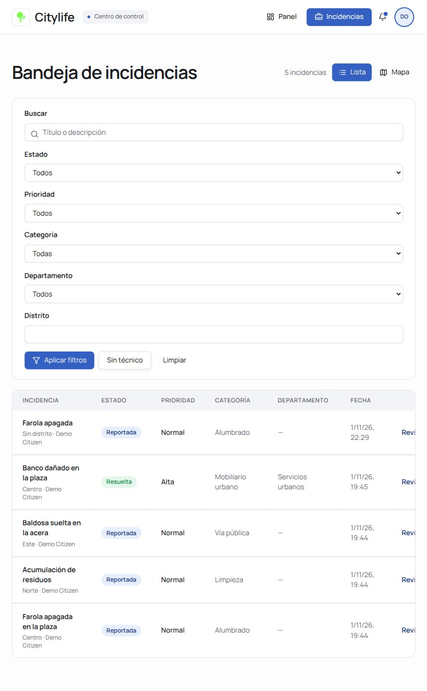

- Estado and Prioridad selects are missing accessible names because their labels have no `htmlFor`/IDs.
- Collapse secondary filters on smaller screens; the filters consume most of the first viewport.
- Make “Sin técnico” an announced toggle and show active-filter chips after applying.
- “Limpiar” should be disabled/hidden with no active filters.
- Add a default operational sort (oldest awaiting validation, urgency, SLA) and sortable column headers.
- The blank final table header needs an accessible label such as “Acciones”.
- Icon-only pagination buttons need accessible names.

### 11. Operations map — incomplete representation

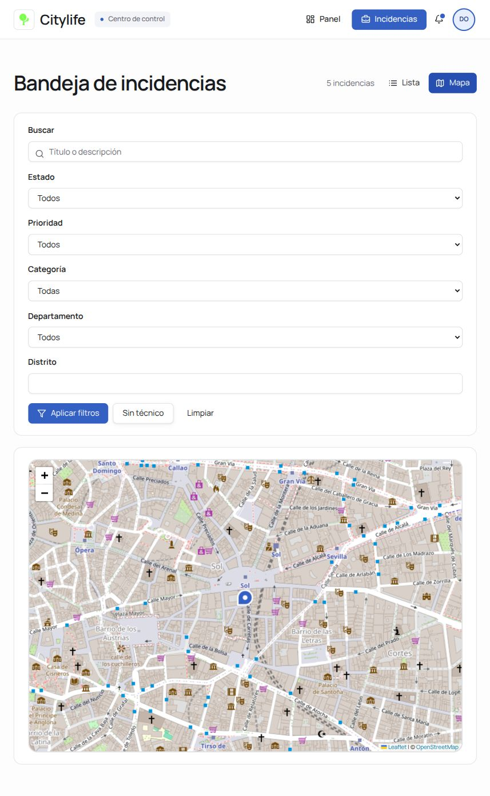

- Only one of five current incidents has coordinates, but the other four disappear completely.
- The map uses only the current paginated page, not all filtered results; communicate this or change the query.
- Keep an adjacent result list and a visible “4 without coordinates” group.
- Announce Lista/Mapa state with `aria-pressed` or tabs.

### 12. Operator incident detail — primary workflow appears too late

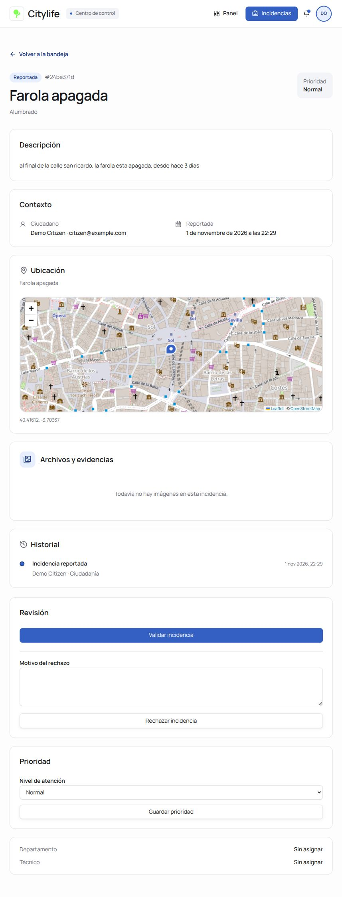

- At the audited width, Review and Priority stack below description, map, attachments and history. Put workflow actions immediately after the title or make them sticky.
- Keep “Reject” collapsed until chosen; an always-open rejection textarea adds noise to the main validation task.
- Validate and Reject change workflow state immediately. Add confirmation/undo appropriate to the business rule and a success announcement.
- Disable “Guardar prioridad” until the value changes and show completion feedback.
- Assignment controls and the read-only Department/Technician summary duplicate each other.
- Minimise personal data: show the citizen email only when contact is part of the operator task.
- Filters expose Reopened and Closed states, but no corresponding operator action exists in the UI. Either implement the lifecycle or remove unsupported states from this surface.

### 13. Technician dashboard — biggest simplification opportunity

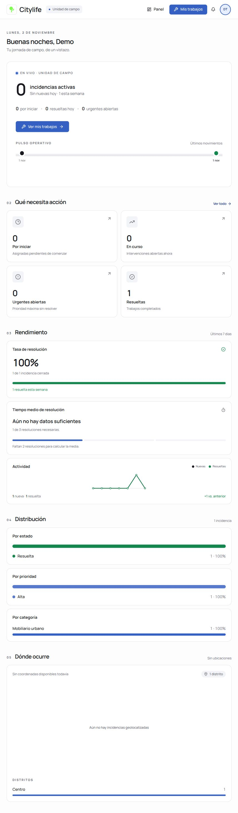

- Replace the analytics dashboard with today’s work queue, next location and primary action.
- Remove four zero-value action cards, resolution-rate analytics based on one job, and the large blank territory panel.
- A 100% resolution rate from one job creates false confidence; show the sample size more prominently or suppress the metric below a threshold.
- “Notificaciones” with no attention count still links to the same work list and adds no function.

### 14. Technician work list — healthy, but completed work will not scale

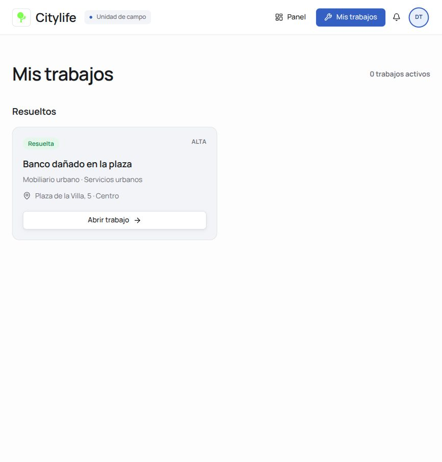

- The active/completed split is clear and the mobile card works well.
- “Abrir trabajo” on a resolved card suggests active work; use “Ver resolución”.
- Collapse or paginate completed jobs and add search/date filtering before the archive grows.
- When there are zero active jobs, lead with that empty state rather than leaving large unused space.

### 15. Technician work detail — active actions need mobile-first ordering

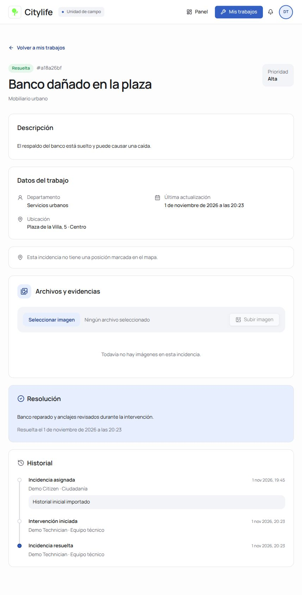

- On active jobs, source order puts Start/Notes/Resolve after description, location, attachments and history at widths below 1024 px. Reorder for field use.
- A separate “no map position” card repeats the absence after a textual address is already shown. Replace it with “Open in maps” when an address exists.
- Upload remains available on resolved work. Decide whether post-resolution evidence is allowed; if not, hide it, and if yes, label it as additional evidence with an audit note.
- Notes and resolution summary can become duplicate writing tasks. Let the resolution reuse/edit notes.
- “Marcar como resuelta” is a consequential state change with no review step, undo or success announcement.

### 16. Mobile technician work list — healthy reflow, oversized header

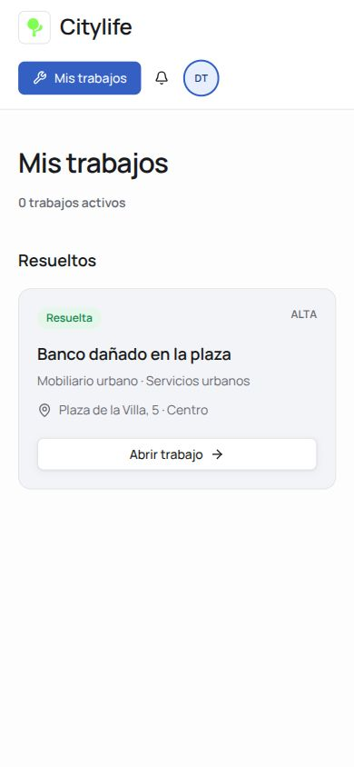

- The work card reflows cleanly.
- The header becomes two rows and consumes significant vertical space; use a compact menu.
- “Panel” disappears and only the logo returns to the dashboard, which is not explicit enough.

### 17. Mobile operations queue — poor

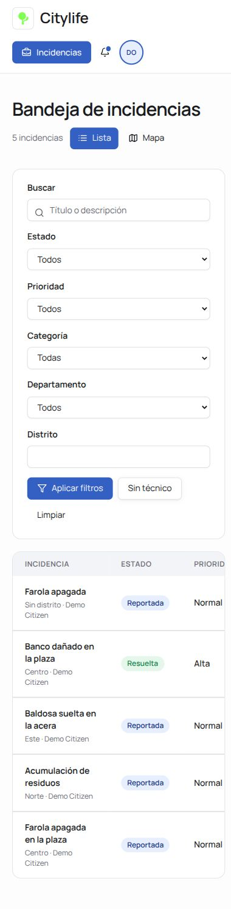

- The table keeps an 850 px minimum width; at 390 px, columns and “Revisar” are off-screen.
- There is no visible scroll instruction/gradient and no sticky action, so users can read a row but cannot obviously open it.
- Convert rows to cards on mobile with title, status, priority, age/SLA and one visible Review action.
- Put filters in a disclosure/drawer and show applied chips above the results.

### 18. Admin dashboard — broken

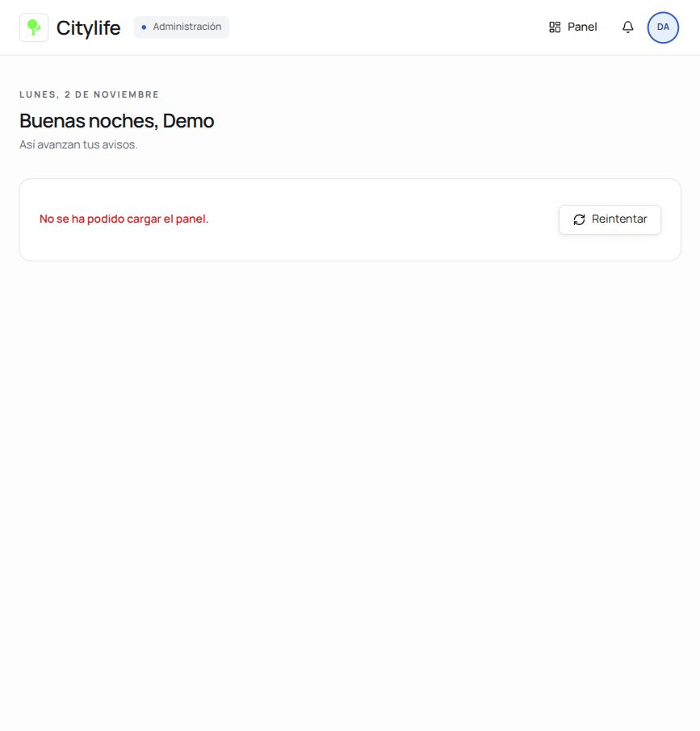

- Admin authenticates successfully but the dashboard API intentionally rejects the role, leaving a generic retry loop.
- The greeting/copy falls back to citizen language (“Así avanzan tus avisos”).
- The notification bell targets the citizen route and redirects back to the broken dashboard.
- Provide a real admin landing surface or remove Admin from demo/provisioning and role labels until supported. Analyst has the same backend denial and no dedicated route.

## Cross-cutting accessibility checklist

- Add a “Saltar al contenido” link and a stable content target.
- Add `aria-current="page"` to role navigation.
- Repair menu keyboard behavior and focus management.
- Connect labels, descriptions and errors; set `aria-invalid` and required semantics.
- Add live announcements for loading, upload, validation, assignment, start, save and resolve results.
- Give every icon-only button an accessible name.
- Expose toggle state for Lista/Mapa and Sin técnico.
- Provide keyboard/non-map equivalents for selecting and understanding locations.
- Darken the resolved badge text and form borders to meet relevant contrast thresholds.
- Ensure hover-only dashboard details also appear on keyboard focus.
- Keep reduced-motion handling; the global media query is a good foundation.
- Test at 200% zoom, keyboard-only, VoiceOver/NVDA and with forced-colors mode; screenshots/source review cannot confirm those behaviors.

## Evidence limits

- The live demo provided Citizen, Operator, Technician and Admin accounts. Analyst was inferred from the same route/backend rules because no demo analyst account was available.
- The seeded technician work was already resolved, so active Start/Notes/Resolve states were assessed from the rendered component order and source, not a live state transition.
- I did not submit, reject, validate, assign, start, resolve, create or upload anything; this kept the audit read-only. Confirmation, undo and post-success focus therefore still need interaction testing.
- Contrast figures were calculated from the declared tokens; a formal WCAG audit should also check all computed states, zoom/reflow, forced colors and assistive technologies.

## Audited step health

1. Public home — Healthy with minor cleanup.
2. Login — Healthy; form accessibility needs refinement.
3. Registration — Needs guidance and required/error semantics.
4. Citizen dashboard — Needs simplification.
5. User menu — Needs keyboard/focus repair.
6. Citizen incident list — Healthy for small datasets.
7. New incident — Usable; optional map dominates and lacks an equivalent input path.
8. Citizen detail — Usable; redundant/technical information should be reduced.
9. Operator dashboard — Functional but too long.
10. Operations queue — Functional on desktop; poor responsive behavior.
11. Operations map — Incomplete representation of results.
12. Operator detail — Functional; primary actions appear too late.
13. Technician dashboard — Overbuilt for the role.
14. Technician work list — Healthy; archive scaling needs work.
15. Technician detail — Functional; action order is poor for mobile field use.
16. Mobile technician list — Healthy reflow with navigation concerns.
17. Mobile operations queue — Poor/blocking.
18. Admin dashboard — Broken.
